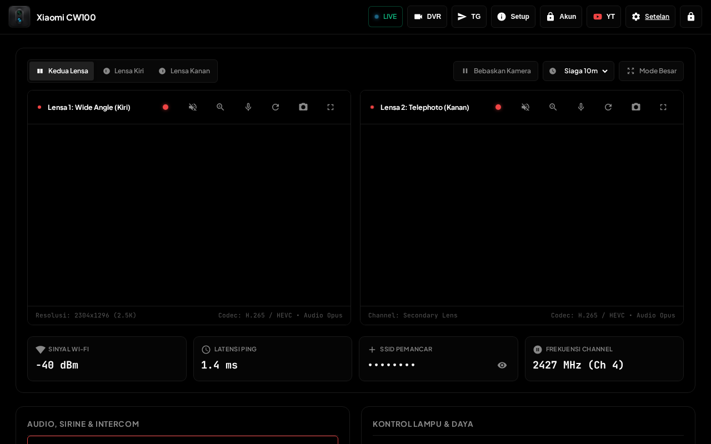
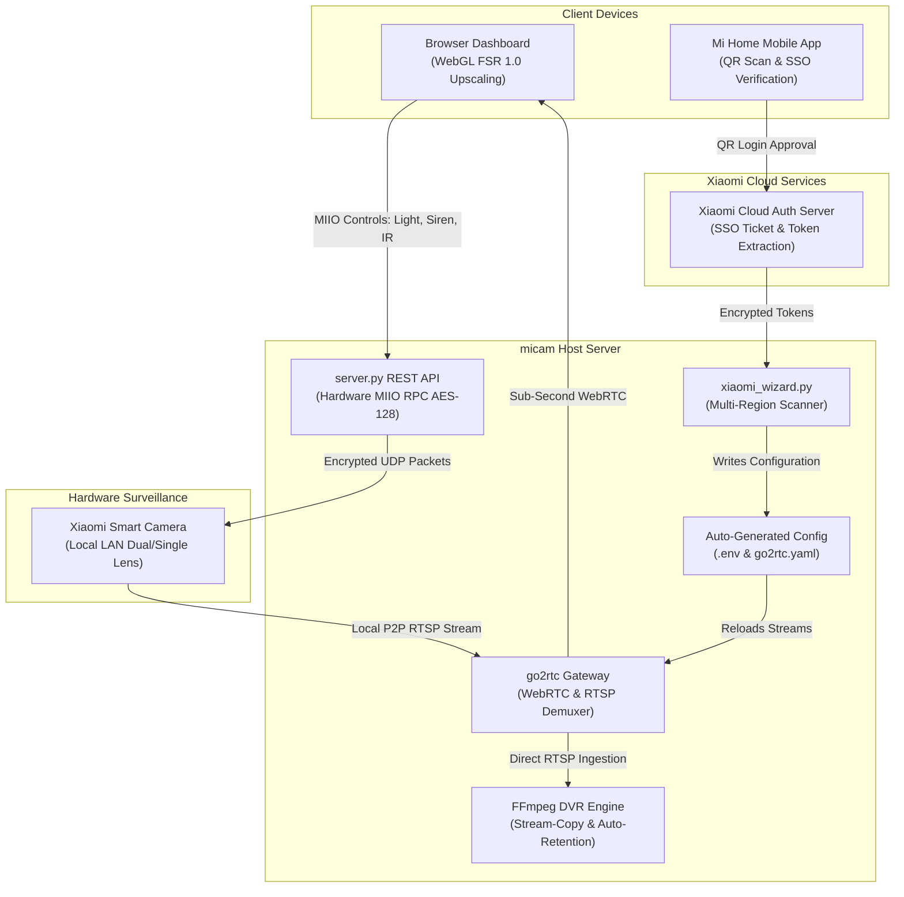

<div align="center">

# micam
### Ultra-Low-Latency WebRTC Surveillance Dashboard, DVR & Hardware Controller for Xiaomi Smart Cameras

[](https://python.org)
[](https://github.com/AlexxIT/go2rtc)
[](https://ffmpeg.org)
[](https://gpuopen.com/fidelityfx-superresolution/)
[](https://github.com)
[](LICENSE)

*A self-hosted, lightweight surveillance platform for Xiaomi smart cameras. Built with native WebRTC, zero-config QR onboarding, zero-CPU DVR recording, and AMD FSR WebGL super-resolution.*

<br>



<br>

---

[Quick Start](#quick-start) • [Features](#key-features) • [Hardware Compatibility](#hardware-compatibility) • [Architecture](#architecture) • [NVR & RTSP](#nvr--third-party-integration) • [Docs](docs/)

</div>

---

## Quick Start

### 1. Prerequisites
- Linux host (Debian, Ubuntu, Raspberry Pi OS, or any Linux server)
- Python 3.8+
- FFmpeg:
  ```bash
  sudo apt-get update && sudo apt-get install -y ffmpeg
  ```

### 2. Install & Launch (1-Command)
```bash
git clone https://github.com/kaivyy/micam.git
cd micam
pip3 install -r requirements.txt
chmod +x start.sh stop.sh
./start.sh
```

> [!TIP]
> `start.sh` automatically detects your system CPU architecture (`x86_64`, `arm64`, `armv7l`) and fetches the latest official `go2rtc` binary if not already present.

### 3. Pair via Web Setup Wizard
Open your browser at:
```text
http://<SERVER_IP>:8088
```
1. The **Setup Wizard** appears automatically on first launch.
2. Scan the on-screen **QR Code** using your **Mi Home** app (or click *Buka Link Verifikasi*).
3. Select your camera from the detected list.
4. Click **Pasang & Aktifkan Kamera Ini** &mdash; live stream starts immediately with zero manual configuration.

To stop the background services:
```bash
./stop.sh
```

---

## Key Features

* **Zero-Config Web Setup Wizard:**
  * No manual terminal editing of IP addresses, DIDs, or 32-character hex tokens.
  * Scan the on-screen QR Code directly with the Mi Home app or click the SSO verification link.
  * Multi-region auto-scanner probes Singapore (`sg`), China Mainland (`cn`), and Global regions automatically.

* **Adaptive Camera Layout (Single-Lens & Dual-Lens):**
  * **Dual-Lens Mode** (CW100 / CW700S): Synchronized dual-stream playback with independent zoom and audio focus.
  * **Single-Lens Mode** (C200 / C300 / C400): Automatically adjusts to a full-width single monitor without empty or offline secondary frames.
  * **P2P Shared-Session Multiplexing (`&shared=1`)**: Multiplexes both dual-lens feeds over a single hardware P2P session to the camera, eliminating device limit lockouts and allowing simultaneous viewing in Mi Home and multiple web dashboards.

* **Ultra-Low Latency Live Streaming (~200ms):**
  * Direct peer-to-peer WebRTC & MSE streaming via integrated `go2rtc` gateway.
  * Sub-second latency without cloud relay buffering or recurring fees.

* **2-Pass WebGL FSR Super-Resolution Zoom:**
  * Client-side GPU-accelerated upscaler based on **AMD FidelityFX Super Resolution (FSR 1.0)**.
  * **Pass 1 (EASU)**: 12-tap directional Lanczos interpolation preserves sharp edge orientation.
  * **Pass 2 (RCAS)**: Ringing-free adaptive sharpening brings out fine details on license plates and faces.
  * Switch on the fly between Standard SVG and 2-Pass FSR.

* **Zero-CPU DVR Recording & 24-Hour Timeline Scrubber:**
  * **Stream-Copy Mode (`-c copy`)**: Saves raw H.265/H.264 bitstreams directly to disk with **~0% CPU usage**.
  * **Continuous 24/7 DVR**: Automatically splits video into segments (5, 15, 30, or 60 minutes).
  * **Instant Scrubbing**: Play recordings in-browser with **HTTP 206 Partial Content Range** seeking.
  * **Storage Retention**: Auto-deletes old files when disk storage reaches safe thresholds or age limits.

* **Local Encrypted Hardware Controls (MIIO RPC AES-128-CBC):**
  * Dual white LED spotlight toggle.
  * Infrared night vision modes (Auto / On / Off).
  * Emergency siren alarm buzzer with visual strobe alert.
  * AI Detection toggles: Motion, Human, and Vehicle analytics.
  * Remote device reboot directly from browser.

* **YouTube Live Streaming Relay (Alternative Cloud DVR):**
  * Stream camera feeds directly to YouTube Live in native 2.5K, 1080p, or 720p.
  * **Dual-Lens Unified Live Broadcast**: Broadcast both lenses simultaneously into a single live stream with customizable layouts (**Side-by-Side**, **Vertical Stack**, or **Picture-in-Picture** with custom corner placement, scaling, and lens swap).
  * In-browser setup modal with step-by-step guidance button for acquiring YouTube Stream Key.
  * Built-in silent audio generator option to safeguard private residential live broadcasts from automated Content ID copyright takedowns.
  * Resilient background supervisor process with automated reconnection during network hiccups.
  * 100% internal loopback: Ingests from local RTSP endpoints (`rtsp://127.0.0.1:8554`), consuming zero additional camera hardware P2P slots.
  * Zero command-line configuration required &mdash; managed entirely from the dashboard UI.

* **Pure OLED Black Design (`#000000`) & Progressive Web App (PWA):**
  * High-contrast interface optimized for AMOLED/OLED displays.
  * Modern titanium squircle app icon & branding with full PWA asset suite (`manifest.json`, `apple-touch-icon.png`, `favicon.svg`).
  * Seamless iOS Safari / Android "Add to Home Screen" standalone app experience.
  * Resilient background tab handling with 30-second grace window and last-frame poster hold to eliminate jarring black screen reloads.
  * Touch targets $\ge 44\times44\text{px}$ adhering to clean anti-slop ergonomics.
  * PIN guard keypad lock screen for shared workstation security.

---

## Hardware Compatibility

| Model Series | Family Name | Lens Type | Tested & Supported Features |
| :--- | :--- | :---: | :--- |
| `chuangmi.camera.075ae1` | Xiaomi Outdoor Camera CW100 Dual | **Dual** | 2.5K WebRTC, Dual Spotlights, Siren, IR, MIIO, FSR |
| `chuangmi.camera.075a` | Xiaomi Outdoor Camera CW700S Dual | **Dual** | 2.5K WebRTC, PTZ + Fixed Lens, Siren, Spotlights, FSR |
| `chuangmi.camera.ipc029` | Xiaomi Smart Camera C300 / C400 | **Single** | 2K/3MP WebRTC, Adaptive Single View, DVR, FSR |
| `mibt.camera.*` | Mi 360° Home Security Camera Series | **Single** | 1080p/2K WebRTC, Adaptive Single View, DVR, FSR |
| `isafe.camera.*` | Xiaomi Outdoor Camera CW400 / AW300 | **Single** | 2.5K WebRTC, Spotlights, Siren, DVR, FSR |

---

## NVR & Third-Party Integration

`micam` exposes standard RTSP streams and WebRTC endpoints locally, allowing seamless integration with **Frigate NVR, Home Assistant, Scrypted, Shinobi, Agent DVR, and VLC**:

| Feed | Local RTSP Stream | WebRTC Web Endpoint |
| :--- | :--- | :--- |
| **Primary Lens (Left / Wide)** | `rtsp://<SERVER_IP>:8554/cctv_lensa_kiri` | `http://<SERVER_IP>:1984/stream.html?src=cctv_lensa_kiri` |
| **Secondary Lens (Right / PTZ)** | `rtsp://<SERVER_IP>:8554/cctv_lensa_kanan` | `http://<SERVER_IP>:1984/stream.html?src=cctv_lensa_kanan` |

*For complete Home Assistant and Frigate configuration examples, see [docs/NVR_INTEGRATION.md](docs/NVR_INTEGRATION.md).*

---

## Architecture



---

## Tech Stack & Standards

- **Core Server:** Python 3.13 (`http.server` & asynchronous MIIO RPC)
- **Streaming Core:** `go2rtc` 1.9+ (AlexxIT)
- **Recording Engine:** FFmpeg 7.1+ (Native stream-copy demuxer)
- **Shader Pipeline:** WebGL 2.0 / 1.0 (AMD FidelityFX EASU + RCAS GLSL)
- **Frontend:** Vanilla JavaScript (ES6+), pure CSS3, 0 external runtime libraries

---

## Documentation Index

- [docs/ARCHITECTURE.md](docs/ARCHITECTURE.md) &mdash; Detailed system architecture and protocol flows.
- [docs/API.md](docs/API.md) &mdash; Comprehensive REST API documentation for `server.py`.
- [docs/NVR_INTEGRATION.md](docs/NVR_INTEGRATION.md) &mdash; Frigate, Home Assistant, and Scrypted guides.
- [docs/TROUBLESHOOTING.md](docs/TROUBLESHOOTING.md) &mdash; Common error solutions and network tuning.

---

## Contributing

Contributions, feature requests, and bug reports are welcome! Please open an issue or pull request on GitHub.

1. Fork the Project
2. Create your Feature Branch (`git checkout -b feature/AmazingFeature`)
3. Commit your Changes (`git commit -m 'feat: add some AmazingFeature'`)
4. Push to the Branch (`git push origin feature/AmazingFeature`)
5. Open a Pull Request

---

## License

Distributed under the **MIT License**. See [`LICENSE`](LICENSE) for more information.

---

<div align="center">
Built with precision for privacy-first, self-hosted smart home surveillance.
</div>
