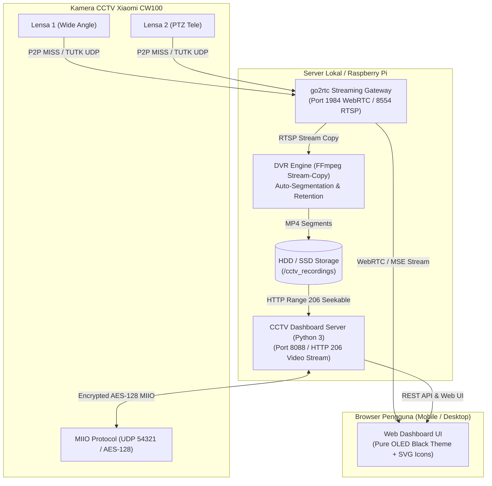

<div align="center">

# Xiaomi Outdoor Camera CW100 Dual
### Surveillance, AI Control & NVR DVR Dashboard

[](https://python.org)
[](https://github.com/AlexxIT/go2rtc)
[](https://ffmpeg.org)
[](https://github.com)
[](LICENSE)

*Sistem dashboard pengawasan, kontrol hardware pintar lokal, AI analytics, dan perekam video (DVR) mandiri (100% self-hosted & self-contained) untuk kamera pintar **Xiaomi Outdoor Camera CW100 Dual-Lens** (`chuangmi.camera.075ae1`).*

---

[Fitur Utama](#fitur-utama) • [Arsitektur](#arsitektur-sistem) • [Instalasi Cepat](#instalasi-cepat) • [Integrasi NVR](#integrasi-nvr--pihak-ketiga) • [Kredit & Referensi](#kredit--referensi-proyek)

</div>

---

## Fitur Utama

- **Dual-Lens Live Streaming Simultan (~200ms Latency):**
  - **Lensa 1:** Sensor Utama *Wide Angle* (2.5K / HD)
  - **Lensa 2:** Sensor Sekunder *PTZ Telephoto* (2.5K / HD)
  - Streaming menggunakan teknologi **WebRTC & MSE** via gateway lokal, menghasilkan latensi sangat minim tanpa buffering cloud.
- **PTZ Direction Controller & Keyboard Navigation:**
  - Navigasi D-Pad interaktif (Atas, Bawah, Kiri, Kanan, Center/Reset) khusus Lensa 2.
  - Mendukung kontrol langsung melalui keyboard (tombol panah dan Spacebar).
- **Emergency Siren / Alarm Suara Darurat:**
  - Memicu sirene buzzer hardware bawaan kamera seketika untuk mengusir penyusup atau peringatan bahaya di lokasi.
  - Dilengkapi animasi strobo visual pada dashboard saat aktif.
- **AI Smart Detection Analytics & Toggle Switch:**
  - Kontrol saklar deteksi pintar langsung ke kamera:
    - **General Motion Detection** (Deteksi Gerakan Umum)
    - **AI Human Detection** (Deteksi AI Bentuk Tubuh Manusia)
    - **AI Vehicle Detection** (Deteksi AI Kendaraan Mobil/Motor)
- **Telegram Alert Bot & Live Snapshot:**
  - Integrasi bot Telegram langsung dari dashboard: kirim notifikasi dan foto snapshot JPEG resolusi tinggi seketika ke ponsel pengguna.
- **24-Hour NVR Timeline Scrubber:**
  - Bilah linimasa 24 jam interaktif visual untuk meninjau rekaman sepanjang hari.
  - Fitur *click-to-seek* untuk langsung memutar rekaman pada jam tertentu.
- **Perekam Video (DVR) Cerdas & Zero-CPU Overhead:**
  - **Stream Copy (`-c copy`):** Video dan audio disalin langsung ke disk tanpa proses rendering ulang (*transcoding*), menjaga penggunaan CPU server mendekati **~0%**.
  - **DVR Otomatis 24/7 (Continuous):** Otomatis merekam dan memecah file video per segmen waktu (**5, 15, 30, atau 60 menit** per file `.mp4`).
  - **Rekam Manual Seketika:** Tombol rekam cepat di atas live feed dengan timer berkedip realtime.
  - **Auto-Cleanup & Manajemen Retensi:** Otomatis menghapus file rekaman terlama berdasarkan masa simpan (**3, 7, 14, 30 hari**) atau saat kapasitas harddisk menyentuh batas aman (< 5 GB).
- **Timelapse Video Generator:**
  - Pembuat video timelapse instan dari kumpulan rekaman DVR dengan akselerasi mulus berbasis FFmpeg.
- **In-Browser Video Player & File Manager:**
  - Putar rekaman langsung di browser dengan dukungan **HTTP 206 Partial Content Range** (bisa digeser maju/mundur dengan instan).
  - Unduh file `.mp4` asli atau hapus dengan satu klik.
- **PIN Security Guard / Lock Screen:**
  - Sistem penguncian dashboard 4 digit PIN dengan dialog keypad numerik untuk mencegah akses kontrol yang tidak diinginkan.
- **Kontrol Hardware Lokal Terenkripsi (MIIO RPC AES-128 CBC):**
  - **Lampu Sorot LED:** Saklar on/off lampu penerangan ganda (*dual white spotlight*).
  - **Night Vision (Infrared):** Mode Malam IR otomatis / nyala / mati.
  - **Sensor Lensa:** Saklar mode siaga (*sleep*) / aktif kedua sensor kamera.
  - **Remote Reboot:** Mulai ulang perangkat CCTV langsung dari browser.
- **Desain Modern Pure OLED Black (`#000000`) & Bespoke SVG Icons:**
  - Tampilan tema hitam pekat tanpa kabur abu-abu, sangat tajam dan hemat daya pada layar OLED/AMOLED.
  - Menggunakan icon vektor SVG inline yang bersih dan profesional tanpa emoji.
  - Desain responsif (*mobile-friendly*) dengan target sentuh ibu jari minimal **44x44px** sesuai kaidah *antislop UI*.
- **Otentikasi Xiaomi Satset di Halaman Web:**
  - Fitur sinkronisasi akun Xiaomi dan form verifikasi OTP terintegrasi langsung di UI tanpa perlu perintah terminal manual.

---

## Arsitektur Sistem

Seluruh komponen dirancang **berdikari penuh (*self-contained*)** di dalam repositori ini:



---

## Struktur Direktori

```text
cctv_dashboard/
├── public/
│   └── index.html         # Antarmuka Dashboard (Pure Black, WebRTC, Controls, SVG Icons, DVR UI)
├── server.py              # Server REST API & Layanan Video Stream HTTP 206 (Port 8088)
├── recorder.py            # Engine Perekam DVR FFmpeg, Retensi Disk & Auto-Cleanup
├── go2rtc.yaml            # Konfigurasi gateway streaming P2P / WebRTC
├── start.sh               # Skrip inisialisasi & peluncuran 1-klik (auto-download go2rtc)
├── stop.sh                # Skrip penghentian layanan
├── requirements.txt       # Dependensi Python (pycryptodome)
├── .env.example           # Template konfigurasi variabel lingkungan
└── README.md              # Dokumentasi lengkap proyek
```

---

## Instalasi Cepat

### 1. Prasyarat Sistem
- **Sistem Operasi:** Linux (Ubuntu, Debian, Raspberry Pi OS, Armbian, dll.)
- **Python:** Versi 3.8 atau lebih baru
- **FFmpeg:** Diperlukan untuk perekaman DVR:
  ```bash
  sudo apt-get update && sudo apt-get install -y ffmpeg
  ```

### 2. Clone Repositori
```bash
git clone https://github.com/<username>/cctv_dashboard.git
cd cctv_dashboard
```

### 3. Instal Dependensi Python
```bash
pip3 install -r requirements.txt
```

### 4. Konfigurasi Variabel Lingkungan (Opsional)
Jika IP kamera atau kredensial token Anda berbeda dari default:
```bash
cp .env.example .env
# Sesuaikan CCTV_CAMERA_IP, CCTV_TOKEN_HEX, atau CCTV_DID
```

### 5. Jalankan Sistem (1-Klik)
```bash
chmod +x start.sh stop.sh
./start.sh
```
> [!NOTE]
> Skrip `start.sh` akan secara otomatis mendeteksi arsitektur prosesor (`x86_64`, `arm64`, `armv7l`) dan mengunduh binary resmi `go2rtc` jika belum tersedia di sistem.

Akses dashboard melalui browser:
```text
http://<IP_SERVER_ANDA>:8088
```

Untuk menghentikan layanan:
```bash
./stop.sh
```

---

## Integrasi NVR / Pihak Ketiga

Stream video RTSP lokal dapat langsung dihubungkan ke software NVR seperti **Frigate, Home Assistant, Scrypted, Zoneminder, Shinobi, atau VLC Media Player**:

| Lensa Kamera | Endpoint RTSP (Lokal) | Endpoint WebRTC / Browser |
| :--- | :--- | :--- |
| **Lensa 1: Wide Angle (Kiri)** | `rtsp://<IP_SERVER>:8554/cctv_garasi_kiri` | `http://<IP_SERVER>:1984/stream.html?src=cctv_garasi_kiri` |
| **Lensa 2: PTZ Tele (Kanan)** | `rtsp://<IP_SERVER>:8554/cctv_garasi_kanan` | `http://<IP_SERVER>:1984/stream.html?src=cctv_garasi_kanan` |

---

## Estimasi Kebutuhan Harddisk (DVR 24/7)

Perekaman resolusi penuh 2.5K / HD dengan kompresi **H.265 (HEVC)** rata-rata memerlukan:
- **1 Lensa:** ~1.5 Mbps (±16 GB per 24 jam)
- **Kedua Lensa (Kiri + Kanan):** **±30 s/d 35 GB per 24 jam**
- **Kapasitas 85 GB:** Menampung ~2.5 hingga 3 hari rekaman nonstop.
- **Kapasitas 500 GB:** Menampung ~15 hingga 16 hari rekaman nonstop.
- **Kapasitas 1 TB:** Menampung ~1 bulan penuh (30 hari) rekaman nonstop.

---

## Kredit & Referensi Proyek

Proyek ini dibangun menggunakan fondasi dan terinspirasi dari proyek-proyek open-source hebat berikut:

- <u>[go2rtc](https://github.com/AlexxIT/go2rtc)</u> — Gateway streaming WebRTC, MSE, dan relay protokol P2P kamera Xiaomi (MISS / TUTK CS2).
- <u>[Xiaomi Cloud Tokens Extractor](https://github.com/PiotrMachowski/Xiaomi-cloud-tokens-extractor)</u> — Ekstraktor token lokal, Device ID, dan otentikasi akun Xiaomi cloud.
- <u>[python-miio](https://github.com/rytilahti/python-miio)</u> — Referensi protokol komunikasi UDP 54321 dan enkripsi AES-128-CBC MIIO.
- <u>[FFmpeg](https://ffmpeg.org)</u> — Framework multimedia untuk engine perekaman DVR *stream-copy* dan pemecah segmen video MP4.

---

## Lisensi

Didistribusikan di bawah lisensi **MIT License**. Silakan gunakan, modifikasi, dan kembangkan secara bebas untuk penggunaan pribadi maupun komunitas.
