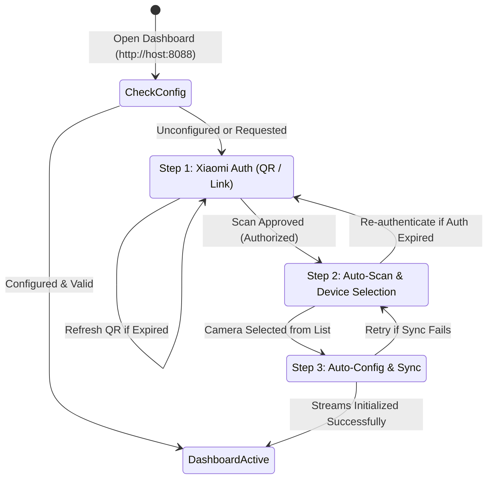

# Design Specification: Web Setup Wizard & Zero-Config Onboarding for Xiaomi CCTV

- **Date:** 2026-10-30
- **Status:** Approved by User
- **Target System:** Linux Headless Mini PC (Ubuntu/Debian) running CCTV Web Dashboard & go2rtc gateway

---

## 1. Executive Summary & Problem Statement

Currently, the CCTV Dashboard supports high-performance dual-lens WebRTC streaming with AMD FSR 2-pass super-resolution, DVR recording, and PTZ controls. However, onboarding a new device or deploying the project on a fresh machine requires manual terminal interactions:
1. Extracting Xiaomi cloud tokens (`passToken`, `ssecurity`, `serviceToken`) via external CLI scripts.
2. Manually retrieving the camera's local IP, DID, and 32-character hex device token.
3. Manually editing configuration files (`.env` and `go2rtc.yaml`).
4. Manually accounting for camera differences (single-lens vs. dual-lens configurations).

This specification outlines the architecture, backend micro-module, REST API endpoints, and user-facing Web Setup Wizard that eliminates manual configuration. An external user cloning the repository can simply open the web dashboard in their browser, scan a QR code with their Mi Home app (or click an SSO login link), select their camera from an automatically discovered list, and immediately start streaming.

---

## 2. Goals & Success Criteria

1. **Zero-Terminal Configuration**: A new user can complete initial setup entirely within the browser UI without touching `.env` or `go2rtc.yaml`.
2. **SSO QR Code & Link Authentication**: Direct integration with Xiaomi Cloud long-polling authentication, displaying an on-screen QR code and a direct verification URL.
3. **Adaptive Multi-Region Scanning**: Seamlessly discovers cameras across server regions (`sg`, `cn`, `de`, `us`, `i2`, `ru`), prioritizing Singapore (`sg`) for SEA/Indonesia and falling back automatically.
4. **Adaptive Camera Mode Detection**:
   - **Dual-Lens Models** (e.g., CW100 `chuangmi.camera.075ae1`, CW700S `chuangmi.camera.075a`): Configures two distinct WebRTC channels (`channel 1` and `channel 2`) with side-by-side / split controls.
   - **Single-Lens Models** (e.g., C200, C300, C400, CW400): Configures a single primary feed and automatically collapses secondary lens UI elements to prevent black/offline frames.
5. **Config File Generation & Service Synchronization**: Automatically persists settings to `.env` and `go2rtc.yaml` with automatic backup (`.bak`), reloads streams, and launches live monitoring.
6. **Re-entrant Setup**: The setup wizard automatically triggers on first launch if unconfigured, but remains accessible anytime from the settings menu for camera swapping or re-authentication.

---

## 3. User Workflow & State Machine



### Flow Details:
1. **First-Run Detection**:
   - On page load, `GET /api/wizard/check` checks if `.env` contains valid `CCTV_CAMERA_IP` and `CCTV_DID`, and if `go2rtc.yaml` contains active streams.
   - If not configured, `#setupWizardModal` opens automatically with backdrop blur.
2. **Step 1: Xiaomi Cloud SSO**:
   - Client calls `POST /api/wizard/start`. Server requests a unique long-polling ticket from `account.xiaomi.com`.
   - UI renders the QR code (220×220px) and a "Buka Link Login di Browser" anchor button.
   - Client polls `GET /api/wizard/status` every 2 seconds. When approved, server captures `userId`, `passToken`, `ssecurity`, and `serviceToken`.
3. **Step 2: Device Discovery**:
   - Client calls `GET /api/wizard/devices`.
   - Server probes `sg`, then `cn`, and other regions, returning filtered camera objects with `name`, `model`, `ip`, `did`, `token`, and `lens_type`.
   - User reviews cards and selects the desired camera.
4. **Step 3: Auto-Config & Launch**:
   - Client posts `{ did, custom_ip }` to `POST /api/wizard/save`.
   - Server writes updated `.env` and `go2rtc.yaml`, reloads go2rtc streams via `/api/config`, reloads the web dashboard state, and closes the wizard.

---

## 4. Backend Architecture: `xiaomi_wizard.py` & REST API

### 4.1 Module: `xiaomi_wizard.py`
Located at `cctv_dashboard/xiaomi_wizard.py`. Built using Python standard libraries plus `pycryptodome` (which is already installed in the environment).

```python
class XiaomiWizardSession:
    def __init__(self):
        self.session = urllib.request / requests
        self.user_id = None
        self.pass_token = None
        self.ssecurity = None
        self.service_token = None
        self.long_poll_url = None
        self.qr_url = None
        self.login_url = None
        self.timeout = 120
        self.created_at = 0

    def start_qr_session(self) -> dict: ...
    def poll_qr_status(self) -> str: ... # "waiting" | "authorized" | "expired"
    def discover_cameras(self) -> list: ...
    def apply_config(self, camera_data: dict, base_dir: str) -> bool: ...
```

### 4.2 REST Endpoints in `server.py`

| Endpoint | Method | Input | Output | Description |
|---|---|---|---|---|
| `/api/wizard/check` | `GET` | None | `{ "configured": bool, "active_camera": {...} }` | Checks if camera configuration is present and active. |
| `/api/wizard/start` | `POST` | None | `{ "success": bool, "qr_url": str, "login_url": str, "timeout": int }` | Generates a new Xiaomi SSO QR and direct link. |
| `/api/wizard/status` | `GET` | None | `{ "state": "waiting"\|"authorized"\|"expired", "user_id": str }` | Checks status of active QR login ticket. |
| `/api/wizard/devices` | `GET` | None | `{ "success": bool, "region": str, "cameras": [ {...} ] }` | Discovers camera devices across account regions. |
| `/api/wizard/save` | `POST` | `{ "did": str, "ip": str (optional) }` | `{ "success": bool, "message": str }` | Writes `.env` and `go2rtc.yaml`, reloads gateway. |

---

## 5. Multi-Region Scanning & Model Detection

### 5.1 Region Probing Strategy
Xiaomi Cloud organizes user homes by region server:
- `sg` (Singapore - default for Southeast Asia / Indonesia)
- `cn` (China Mainland - common for imported/distributor cameras)
- `de` (Europe)
- `us` (United States)
- `i2` (India)
- `ru` (Russia)

The wizard initiates queries against `sg`. If device count is 0, it iterates sequentially through `cn`, `de`, `us` without requiring user intervention. The active region where cameras are found is persisted in `XIAOMI_REGION`.

### 5.2 Single-Lens vs. Dual-Lens Detection

| Model Signature | Camera Name / Family | Lens Type | Stream Configuration (`go2rtc.yaml`) |
|---|---|---|---|
| `chuangmi.camera.075ae1` | Xiaomi Outdoor CW100 Dual | `dual` | `cctv_lensa_kiri` (channel 1), `cctv_lensa_kanan` (channel 2) |
| `chuangmi.camera.075a` | Xiaomi Outdoor CW700S Dual | `dual` | `cctv_lensa_kiri` (channel 1), `cctv_lensa_kanan` (channel 2) |
| Any model with `dual` or secondary channel | Generic Dual-Lens | `dual` | 2 stream channels enabled |
| `chuangmi.camera.*` / `isafe.*` / other | C200 / C300 / C400 / CW400 | `single` | `cctv_lensa_kiri` (single primary stream), hide lens 2 UI |

---

## 6. Frontend UI / UX Architecture

### 6.1 Modal Architecture (`#setupWizardModal`)
- **Theme**: Antislop Dark Architecture (`#000000`, surface `#0d0f12`, border `#222222`, accent `#10b981`).
- **Typography**: System sans-serif with monospace accents (`JetBrains Mono` for IP, DID, model tags).
- **Responsive**: Full touch compatibility with minimum 44px touch targets on mobile viewports (390px - 430px) and modal width capped at 540px on desktop.

### 6.2 UI Steps Layout
1. **Header**: "Pengaturan Kamera CCTV Xiaomi" + Close button (if already configured).
2. **Step Indicators**: Progress pills `[1. Hubungkan Akun] -> [2. Pilih Kamera] -> [3. Mulai]`.
3. **Step 1 Panel**:
   - High-contrast QR box (`#wizardQrImg`) with white background padding for QR camera reader clarity.
   - Text button: `<a target="_blank" class="btn btn-secondary">Buka Link Login di Tab Baru</a>`.
   - Pulsing status message: `<div class="wizard-status-pulse">Menunggu scan dari aplikasi Mi Home...</div>`.
4. **Step 2 Panel**:
   - Camera cards list (`.camera-select-card`) with selectable active radio state.
   - Lens badge: `<span class="badge badge-dual">Dual-Lens 2.5K</span>` or `<span class="badge badge-single">Single-Lens</span>`.
   - Inline IP edit field in case DHCP reassigned local IP address.
   - Submit button: `[ Pasang & Aktifkan Kamera ]`.
5. **Step 3 Panel**:
   - Animated progress spinner & checklist:
     - `[✔] Konfigurasi tersimpan (.env & go2rtc.yaml)`
     - `[✔] Sinkronisasi gateway stream WebRTC`
     - `[✔] Memulai koneksi kamera...`
   - Closes wizard automatically upon stream handshake.

---

## 7. Error Handling & Resilience

1. **QR Timeout**: After 120s, if unconfirmed, status changes to `expired`. A clear "Buat QR Baru" button appears.
2. **No Cameras in Account**: If scanning yields 0 cameras, modal presents guidance:
   *"Tidak ditemukan kamera CCTV di akun ini (diperiksa di server sg, cn, global). Pastikan kamera sudah terdaftar di aplikasi Mi Home."*
3. **Network Failure / Stale Token**: If Xiaomi SSO server returns HTTP 401/403 or network drops, a retry button is provided without forcing a page reload.
4. **Safe File Updates**: Backups of `.env` and `go2rtc.yaml` are saved as `.env.bak` and `go2rtc.yaml.bak` before any write operation. If generation fails, original files are untouched.

---

## 8. Verification & Testing Plan

1. **Unit Tests (`tests/test_xiaomi_wizard.py`)**:
   - Mock Xiaomi Cloud login response and verify QR URL parsing.
   - Test long-polling status parsing (`waiting`, `authorized`, `expired`).
   - Test multi-region camera parsing and filtering.
   - Test config generator for both dual-lens and single-lens models.
2. **End-to-End API Verification**:
   - Test `/api/wizard/check` reports accurate initial status.
   - Test `/api/wizard/start` successfully initializes session.
3. **UI / Playwright Verification (`tests/verify_setup_wizard_ui.py`)**:
   - Verify modal renders correctly on Desktop (1920×1080) and Mobile (390×844).
   - Verify QR image, link, and step transitions work with 0 console errors.
   - Verify antislop accessibility (touch targets >= 44px, contrast ratio >= 4.5:1).
